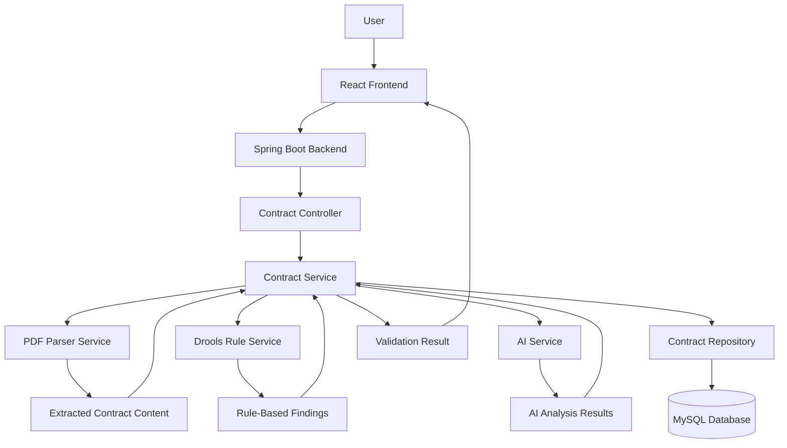

# ⚖️ Legal Contract Validator

### AI-Assisted Contract Analysis with Spring Boot, React & Drools

[](https://www.java.com/)
[](https://spring.io/projects/spring-boot)
[](https://react.dev/)
[](https://www.mysql.com/)
[](https://www.drools.org/)
[](LICENSE)

**Legal Contract Validator** is a full-stack web application designed to help users analyze legal contracts, identify potential issues, and review contract-related risks through a structured validation workflow.

Built with a **Spring Boot backend**, a **React frontend**, a **MySQL database**, and a **Drools-based rule engine**, the application combines backend business logic, document processing, rule-based validation, and AI-assisted analysis in one web interface.

> **Disclaimer:** This application is intended for preliminary contract review and educational or informational purposes. It does not replace advice from a qualified legal professional.

---

## 📌 Table of Contents

- [Overview](#-overview)
- [Key Features](#-key-features)
- [Technology Stack](#-technology-stack)
- [System Architecture](#-system-architecture)
- [Project Structure](#-project-structure)
- [Prerequisites](#-prerequisites)
- [Installation and Setup](#-installation-and-setup)
- [Environment Configuration](#-environment-configuration)
- [Running the Application](#-running-the-application)
- [Application Workflow](#-application-workflow)
- [API Documentation](#-api-documentation)
- [Security and Privacy](#-security-and-privacy)
- [Limitations](#-limitations)
- [Future Improvements](#-future-improvements)
- [Contributing](#-contributing)
- [Author](#-author)
- [License](#-license)

## 📖 Overview

Legal contracts often contain complex clauses, lengthy documents, and conditions that require careful review. Manually reviewing every section can be time-consuming, particularly when users need an initial assessment of possible issues.

Legal Contract Validator aims to simplify this process by providing a web-based interface for submitting contracts and reviewing validation results.

The application brings together:

- **Document processing** for extracting contract content from uploaded PDF files.
- **Rule-based validation** using Drools and configurable business rules.
- **AI-assisted analysis** through the application's AI service.
- **Persistent storage** using MySQL.
- **Interactive results visualization** through a React-based dashboard.

The goal is to provide a structured preliminary review experience while keeping the validation workflow modular and extensible.

## ✨ Key Features

### 📄 Contract Upload and Processing
- Upload contract documents through a web interface.
- Support PDF-oriented document processing.
- Extract contract content for downstream analysis.

### ⚖️ Rule-Based Contract Validation
- Apply configurable validation rules using the Drools rule engine.
- Identify potential contract issues according to implemented rules.
- Separate validation logic from other application components.

### 🤖 AI-Assisted Analysis
- Integrate an AI service into the contract-analysis workflow.
- Support extending the analysis pipeline with additional AI capabilities.
- Keep AI-related functionality within a dedicated backend service.

### 📊 Interactive Results Dashboard
- Present validation results in a structured interface.
- Display identified issues and related information.
- Use visual components to help users understand the results.

### 🗄️ Database Integration
- Connect the backend to MySQL.
- Organize contract-related data through model and repository layers.
- Initialize the database schema through the configured SQL initialization process.

### 🧩 Modular Full-Stack Architecture
- Maintain separate frontend and backend codebases within one repository.
- Use dedicated controllers, services, repositories, and configuration classes.
- Support future feature expansion without tightly coupling every component.

## 🛠️ Technology Stack

| Layer | Technologies |
|---|---|
| Backend | Java 21, Spring Boot |
| Frontend | React, JavaScript, CSS |
| Database | MySQL |
| Rule Engine | Drools |
| Document Processing | PDF parsing service |
| API Communication | REST-style HTTP endpoints |
| Data Access | Spring JDBC / repository layer |
| Build Tool | Maven |
| Frontend Package Manager | npm |
| Version Control | Git and GitHub |

*The table reflects the technologies indicated by the current project structure. Verify the exact dependency versions in `pom.xml` and `frontend/package.json` before publishing a version-specific technology list.*

## 🏗️ System Architecture

The application follows a layered full-stack architecture.



### Architectural Components

- **React Frontend:** Provides the contract upload interface, PDF preview, navigation, and validation-results dashboard.
- **Spring Boot Backend:** Handles HTTP requests and coordinates the application workflow.
- **Contract Controller:** Exposes the contract-related backend operations.
- **Contract Service:** Coordinates contract-processing and validation tasks.
- **PDF Parser Service:** Handles PDF content extraction.
- **Drools Rule Service:** Applies configured business rules.
- **AI Service:** Encapsulates the application's AI integration.
- **Contract Repository:** Manages contract-related persistence.
- **MySQL:** Stores application data according to the configured schema.

*The diagram illustrates the intended high-level component flow. The exact execution sequence and persistence behavior depend on the implementation.*

## 📂 Project Structure

```text
Legal-Contract-Validator/
│
├── frontend/
│   ├── public/
│   │   └── index.html
│   ├── src/
│   │   ├── components/
│   │   │   ├── FileUpload.jsx
│   │   │   ├── Navbar.jsx
│   │   │   ├── PDFPreviewer.jsx
│   │   │   ├── ResultDashboard.jsx
│   │   │   ├── RiskChart.jsx
│   │   │   └── RiskMeter.jsx
│   │   ├── services/
│   │   │   └── api.js
│   │   ├── App.js
│   │   ├── index.css
│   │   └── index.js
│   ├── package.json
│   └── tailwind.config.js
│
├── src/
│   └── main/
│       ├── java/com/legalvalidator/
│       │   ├── config/
│       │   │   ├── DroolsConfig.java
│       │   │   └── WebConfig.java
│       │   ├── controller/
│       │   │   └── ContractController.java
│       │   ├── model/
│       │   │   ├── Contract.java
│       │   │   ├── Issue.java
│       │   │   └── ValidationResult.java
│       │   ├── repository/
│       │   │   └── ContractRepository.java
│       │   ├── service/
│       │   │   ├── AIService.java
│       │   │   ├── ContractService.java
│       │   │   ├── DroolsRuleService.java
│       │   │   └── PDFParserService.java
│       │   └── LegalValidatorApplication.java
│       │
│       └── resources/
│           ├── rules/
│           │   └── contract-rules.drl
│           ├── application.properties
│           └── schema.sql
│
├── .gitignore
├── mvnw
├── mvnw.cmd
├── pom.xml
└── README.md
```

## ⚙️ Prerequisites

Install the following before running the project:

- **Java Development Kit (JDK) 21**
- **Apache Maven**, or use the included Maven Wrapper
- **Node.js and npm**
- **MySQL Server**
- **Git**

An AI provider's API credentials may also be required, depending on the configuration of `AIService.java`.

## 🚀 Installation and Setup

### 1. Clone the Repository

```bash
git clone https://github.com/afrin2326/Legal-Contract-Validator.git
cd Legal-Contract-Validator
```

### 2. Configure the MySQL Database

Create the database configured for your application. For example, if you use `legal_validator`:

```sql
CREATE DATABASE legal_validator;
```

The database name must match the JDBC URL configured through your environment variables.

### 3. Configure Environment Variables

The backend reads its database connection settings from environment variables.

**Git Bash:**

```bash
export DB_URL="jdbc:mysql://localhost:3306/legal_validator"
export DB_USERNAME="your_mysql_username"
export DB_PASSWORD="your_mysql_password"
```

Replace the example values with your own local database configuration.

If the AI service requires an API token, configure it separately using the environment-variable name expected by `AIService.java`.

**Important:** Never commit real passwords, API keys, or access tokens to GitHub.

### 4. Install Frontend Dependencies

Open a terminal in the project root and run:

```bash
cd frontend
npm install
```

### 5. Start the Backend

Open a separate terminal in the project root:

```bash
./mvnw spring-boot:run
```

On Windows Command Prompt, use:

```bat
mvnw.cmd spring-boot:run
```

The configured backend port is **8985**.

### 6. Start the Frontend

In the frontend terminal:

```bash
npm start
```

The development URL depends on the React configuration; a common default is `http://localhost:3000`.

Ensure the frontend API configuration points to the running backend. Check `frontend/src/services/api.js` and the backend CORS configuration if requests fail.

> **Setup note:** The exact database name, AI environment variables, and frontend-to-backend URL should be verified against the current source code before deployment.

## 🔄 Application Workflow

1. **Upload a contract:** The user selects a supported contract document through the frontend.
2. **Process the document:** The backend receives the request and extracts relevant content from the PDF.
3. **Perform validation:** The backend coordinates the configured rule-based checks and AI-assisted analysis.
4. **Generate results:** The application prepares structured validation results and identified issues.
5. **Review the dashboard:** The frontend presents the available results through the dashboard and visualization components.

The workflow describes the intended user journey; the exact behavior depends on the implemented controller and service logic.

## 🔌 API Documentation

The backend exposes contract-related HTTP operations through `ContractController.java`. The frontend communicates with the backend through:

```text
frontend/src/services/api.js
```

For the authoritative API contract, inspect the controller mappings and frontend API calls.

Document each endpoint using the following format once its actual route and HTTP method have been verified:

| Method | Endpoint | Purpose |
|---|---|---|
| `POST` | `<actual-upload-endpoint>` | Submit a contract for processing |
| `GET` | `<actual-result-endpoint>` | Retrieve validation results, if implemented |

The endpoint paths above are placeholders, not confirmed routes. Replace them with the actual mappings from the source code before publishing the README.

## 🔐 Security and Privacy

Legal documents may contain confidential or personally identifiable information. Security should therefore be a core consideration.

- Store credentials in environment variables rather than source files.
- Keep `.env` files and local secrets out of version control.
- Validate uploaded files and enforce appropriate file-size limits.
- Restrict access to uploaded documents and stored contract information.
- Avoid logging confidential contract text or sensitive data.
- Configure CORS and deployment settings for the intended environment.
- Review third-party AI-provider data handling before submitting confidential documents.

The application currently configures a maximum upload size of **10 MB per file**. Production deployments should also consider authentication, authorization, rate limiting, and secure transport as appropriate to the implementation.

## ⚠️ Limitations

- Automated findings may be incomplete or incorrect.
- Rule-based validation depends on the rules configured in the application.
- AI-generated analysis may require independent verification.
- Legal requirements vary by jurisdiction and contract type.
- Successful operation depends on the database, backend, frontend, and any required AI service being configured correctly.

**This application does not provide legal advice and should not be used as the sole basis for legal decisions.** Have consequential contracts reviewed by a qualified legal professional.

## 🛣️ Future Improvements

Potential enhancements include:

- [ ] Expand contract validation rules for additional document types.
- [ ] Add user authentication and role-based authorization.
- [ ] Introduce contract history and version comparison.
- [ ] Support additional document formats.
- [ ] Improve AI-assisted clause classification and explanation.
- [ ] Add downloadable validation reports.
- [ ] Provide more detailed clause-level risk explanations.
- [ ] Add automated unit and integration tests.
- [ ] Introduce Docker-based deployment.
- [ ] Add CI/CD workflows for automated builds and testing.
- [ ] Improve audit logging and document-retention controls.

These are proposed enhancements, not claims about currently implemented features.

## 🤝 Contributing

Contributions, suggestions, and bug reports are welcome.

1. Fork the repository.
2. Create a feature branch.
3. Implement and test your changes.
4. Commit your work with a descriptive message.
5. Open a pull request explaining the changes.

For significant changes, consider opening an issue first to discuss the proposed approach.

## 👩‍💻 Author

**Mst Afrin Binte Amin**

Computer Science and Engineering | AI/ML Enthusiast | Software Developer

- **GitHub:** [@afrin2326](https://github.com/afrin2326)
- **LinkedIn:** [Connect on LinkedIn](https://www.linkedin.com/in/afrin-binte-amin-48a52b417/)

## 📄 License

This project does not yet specify a confirmed open-source license. Add a `LICENSE` file and update this section before distributing the project under an open-source license.

---

<p align="center">
  <sub>Built to explore the intersection of software engineering, rule-based systems, and AI-assisted contract analysis.</sub>
</p>
